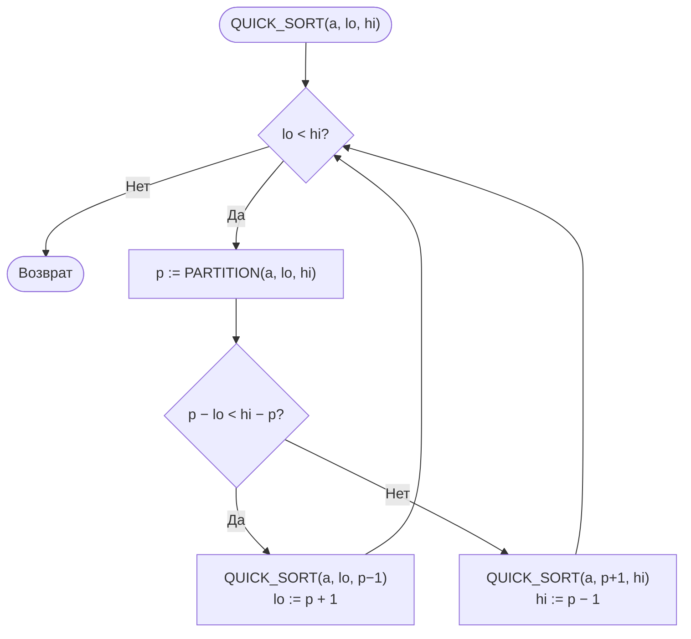
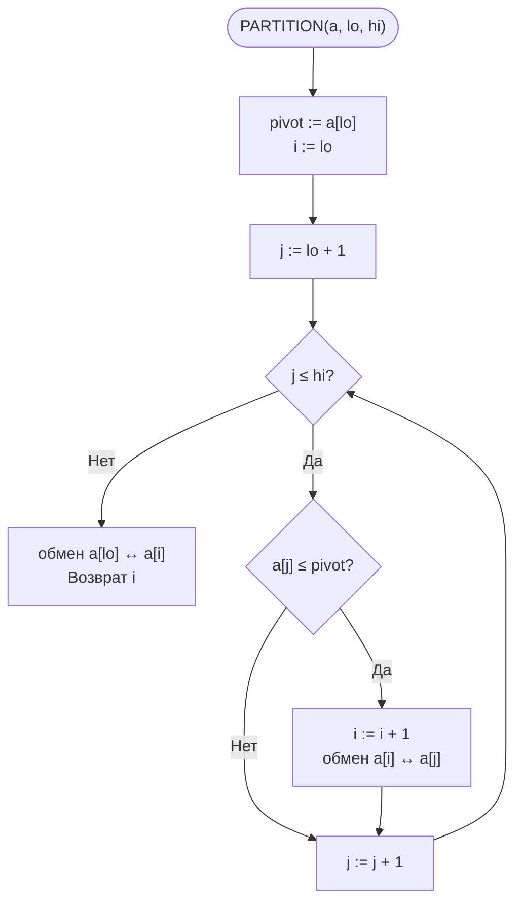
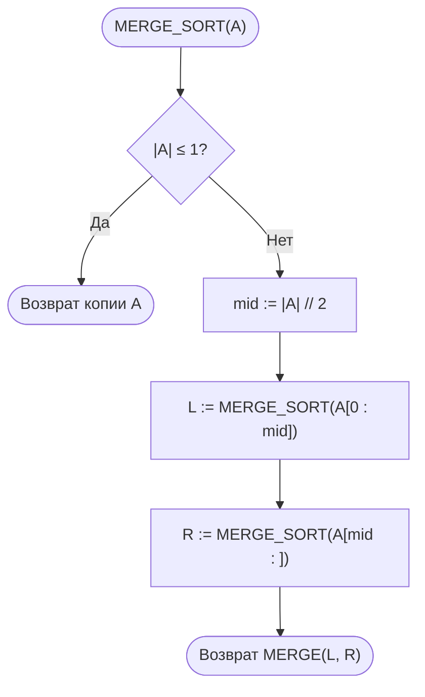
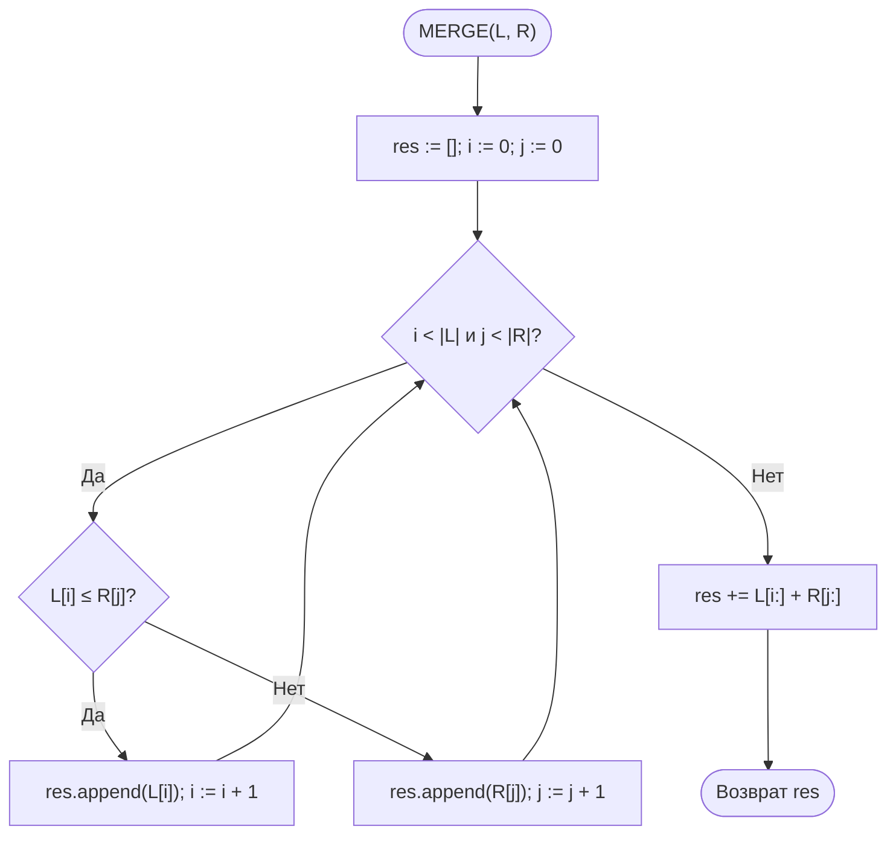

# Лабораторная работа № 3

## Эмпирический анализ временной сложности алгоритмов сортировки. Часть 2: алгоритмы на основе парадигмы «разделяй и властвуй»

**Дисциплина:** Теория алгоритмов
**Направление подготовки:** 38.03.05 «Бизнес-информатика»
**Курс:** 2
**Студент:** Хавторин Леонид (ГУУ)
**Вариант:** 22
**Язык реализации:** Python 3.10+

---

## 1. Задание варианта 22

Из табл. 2 методических указаний:

| Параметр | Значение |
|---|---|
| **Опорный элемент** | П — первый элемент |
| **Схема разбиения** | Л — схема Ломуто |
| **Слияние** | Н — нисходящее (рекурсивное) |
| **Размеры $n$ для эксперимента 2** | 10 000; 20 000; 40 000; 60 000 |
| **Дополнительное задание** | **Г4** — измерить максимальную глубину рекурсии для каждого алгоритма на данных R, S, V и объяснить результаты |

**Формулировка задания.** Реализовать быструю сортировку с опорным элементом «первый» и разбиением по схеме Ломуто, а также нисходящую (рекурсивную) сортировку слиянием. Провести эксперименты 1–3, выполнить дополнительное задание Г4. Сравнить с алгоритмами из ЛР № 2 (`bubble_sort`, `insertion_sort`) и встроенной `sorted()`.

> **Важно.** Согласно примечанию в методических указаниях, при использовании опорного элемента «первый» эксперимент 3 на упорядоченных данных (S) и обратно упорядоченных (V) проводится при $n \le 3000$, иначе время работы и глубина рекурсии становятся неприемлемыми. Это явление необходимо объяснить в выводах.

---

## 2. Цель работы

Изучить рекурсивные алгоритмы сортировки, построенные по принципу «разделяй и властвуй», экспериментально подтвердить их сложность $O(n \log n)$ и провести сравнительный анализ с квадратичными алгоритмами из ЛР № 2. Дополнительно — исследовать глубину рекурсии (задание Г4).

---

## 3. Теоретическая часть

### 3.1. Парадигма «разделяй и властвуй»

Решение задачи строится в три этапа: **разделение** на подзадачи меньшего размера, **властвование** (рекурсивное решение подзадач, базовый случай — малые подзадачи), **комбинирование** решений. Трудоёмкость описывается рекуррентным соотношением

$$T(n) = a \cdot T\!\left(\frac{n}{b}\right) + f(n).$$

Для алгоритмов, делящих задачу пополам ($a = b = 2$) с линейными затратами $f(n) = \Theta(n)$, по основной теореме $T(n) = \Theta(n \log n)$.

### 3.2. Нижняя оценка для сортировок сравнением

Любой алгоритм, упорядочивающий элементы только попарными сравнениями, в худшем случае выполняет $\Omega(n \log n)$ сравнений (модель дерева решений: не менее $n!$ листьев, высота $\ge \log_2(n!) = \Theta(n \log n)$). Сортировка слиянием **асимптотически оптимальна** среди сортировок сравнением.

### 3.3. Сортировка слиянием (нисходящая, вариант Н)

- **Разделение:** массив делится пополам.
- **Властвование:** каждая половина сортируется рекурсивно; массив из 0 или 1 элемента упорядочен.
- **Комбинирование:** две упорядоченные половины сливаются за $\Theta(n)$.

**Слияние.** Два указателя движутся по левому и правому подмассивам; на каждом шаге меньший из текущих элементов переносится в результат. Нестрогое сравнение `left[i] <= right[j]` обеспечивает **устойчивость**.

**Рекуррентность** (одинакова во всех случаях):

$$T(n) = 2\,T(n/2) + \Theta(n) \;\Rightarrow\; T(n) = \Theta(n \log n).$$

**Недостаток:** требуется $\Theta(n)$ дополнительной памяти.

**Глубина рекурсии:** $\lceil \log_2 n \rceil + 1$ — не зависит от структуры данных.

### 3.4. Быстрая сортировка (вариант 22: опорный — первый, разбиение Ломуто)

- **Разделение:** выбирается опорный элемент (в нашем варианте — **первый**), массив переупорядочивается так, что слева — элементы, не большие опорного, справа — не меньшие.
- **Властвование:** обе части сортируются рекурсивно.
- **Комбинирование:** не требуется (сортировка на месте).

**Схема Ломуто.** Один указатель $i$ обозначает границу «малых» элементов. Опорный элемент — первый (в классической схеме Ломуто обычно последний; при опорном «первый» его удобно мысленно поменять с последним либо адаптировать схему). Проход по $j$ от $lo+1$ до $hi$: если $a[j] \le pivot$, то $i{+}{+}$ и обмен $a[i] \leftrightarrow a[j]$. В конце опорный элемент ставится на позицию $i$.

**Выбор опорного элемента «первый» критически важен:**

| Стратегия | Поведение на упорядоченном массиве |
|---|---|
| **Первый элемент** | **Худший случай $\Theta(n^2)$**: разбиения максимально несбалансированы (слева 0 элементов, справа $n-1$) |
| Средний / случайный / медиана трёх | $\Theta(n \log n)$ |

**Оценки:**

- лучший и средний случаи: $T(n) = \Theta(n \log n)$;
- худший случай: $T(n) = T(n-1) + \Theta(n) \Rightarrow \Theta(n^2)$; глубина рекурсии достигает $n$.

Именно поэтому для варианта 22 на данных S и V при больших $n$ возникает `RecursionError` (лимит Python ≈ 1000 вызовов) и резкий рост времени — это и нужно продемонстрировать в задании Г4.

**Приём ограничения глубины рекурсии:** рекурсивно обрабатывать **меньшую** часть, а большую — в цикле; тогда глубина стека $O(\log n)$ даже в худшем случае. В реализации ниже этот приём применён.

### 3.5. Встроенная сортировка Python (Timsort)

`sorted()` и `list.sort()` реализуют гибридный устойчивый алгоритм на основе сортировки слиянием и вставками (выделение упорядоченных runs, их слияние). Написан на C, поэтому на порядок быстрее реализаций на чистом Python. Используется **как эталон**.

### 3.6. Сводная характеристика алгоритмов

**Таблица 1. Сравнение алгоритмов сортировки**

| Алгоритм | Лучший | Средний | Худший | Доп. память | Устойчивость | Глубина рекурсии |
|---|---|---|---|---|---|---|
| Пузырьком | $\Theta(n)$ | $\Theta(n^2)$ | $\Theta(n^2)$ | $O(1)$ | Да | — |
| Вставками | $\Theta(n)$ | $\Theta(n^2)$ | $\Theta(n^2)$ | $O(1)$ | Да | — |
| Слиянием (Н) | $\Theta(n \log n)$ | $\Theta(n \log n)$ | $\Theta(n \log n)$ | $\Theta(n)$ | Да | $\Theta(\log n)$ |
| Быстрая (П, Л) | $\Theta(n \log n)$ | $\Theta(n \log n)$ | $\Theta(n^2)$ | $O(\log n)$* | Нет | $O(n)$** |
| Timsort (`sorted`) | $\Theta(n)$ | $\Theta(n \log n)$ | $\Theta(n \log n)$ | $O(n)$ | Да | — |

\* при оптимизации «рекурсия в меньшую часть»; без неё — $O(n)$.
\** без оптимизации; с оптимизацией — $O(\log n)$.

---

## 4. Блок-схемы

### 4.1. Быстрая сортировка (опорный — первый, Ломуто)



### 4.2. Разбиение Ломуто (опорный — первый)



### 4.3. Сортировка слиянием (нисходящая)





### 4.4. Дерево рекурсии быстрой сортировки на упорядоченных данных (худший случай)

```
quick_sort(a[0..n-1]), pivot = a[0]
├── quick_sort(a[0..-1])          — пусто, базовый случай
└── quick_sort(a[1..n-1]), pivot = a[1]
    ├── quick_sort(a[1..0])       — пусто
    └── quick_sort(a[2..n-1]), pivot = a[2]
        └── ... (глубина n)
```

Глубина рекурсии — $n$, суммарная работа $\sum_{k=1}^{n} k = \Theta(n^2)$.

---

## 5. Листинг программы

Модуль `lr3_v22.py` (используются `sorts_common.py` и `lr2.py` из ЛР № 2: `generate_data`, `measure`, `bubble_sort`, `insertion_sort`).

```python
"""
Лабораторная работа № 3. Вариант 22.
Быстрая сортировка: опорный — ПЕРВЫЙ элемент, разбиение ЛОМУТО.
Сортировка слиянием: НИСХОДЯЩАЯ (рекурсивная).
Доп. задание Г4: измерение максимальной глубины рекурсии на данных R, S, V.
Студент: Хавторин Леонид (ГУУ).
"""
import sys
import random
from sorts_common import generate_data, measure
from lr2 import bubble_sort, insertion_sort


# ---------- Быстрая сортировка: опорный — первый, Ломуто ----------
def quick_sort(arr):
    a = arr.copy()
    _quick_sort(a, 0, len(a) - 1)
    return a


def _quick_sort(a, lo, hi):
    while lo < hi:
        p = _partition_lomuto(a, lo, hi)
        # рекурсия в МЕНЬШУЮ часть — глубина стека O(log n) даже в худшем случае
        if p - lo < hi - p:
            _quick_sort(a, lo, p - 1)
            lo = p + 1
        else:
            _quick_sort(a, p + 1, hi)
            hi = p - 1


def _partition_lomuto(a, lo, hi):
    """Разбиение Ломуто, опорный элемент — ПЕРВЫЙ (вариант 22)."""
    pivot = a[lo]
    i = lo                       # граница «малых» элементов
    for j in range(lo + 1, hi + 1):
        if a[j] <= pivot:
            i += 1
            a[i], a[j] = a[j], a[i]
    a[lo], a[i] = a[i], a[lo]    # ставим опорный на место
    return i


# ---------- Сортировка слиянием: нисходящая ----------
def merge_sort(arr):
    if len(arr) <= 1:
        return arr.copy()
    mid = len(arr) // 2
    return _merge(merge_sort(arr[:mid]), merge_sort(arr[mid:]))


def _merge(left, right):
    result = []
    i = j = 0
    while i < len(left) and j < len(right):
        if left[i] <= right[j]:          # «<=» обеспечивает устойчивость
            result.append(left[i])
            i += 1
        else:
            result.append(right[j])
            j += 1
    result.extend(left[i:])
    result.extend(right[j:])
    return result


# ---------- Задание Г4: измерение максимальной глубины рекурсии ----------
def quick_sort_max_depth(arr):
    """Возвращает (отсортированный массив, максимальная глубина рекурсии)."""
    a = arr.copy()
    max_depth = [0]

    def rec(lo, hi, depth):
        if depth > max_depth[0]:
            max_depth[0] = depth
        while lo < hi:
            p = _partition_lomuto(a, lo, hi)
            if p - lo < hi - p:
                rec(lo, p - 1, depth + 1)
                lo = p + 1
            else:
                rec(p + 1, hi, depth + 1)
                hi = p - 1

    rec(0, len(a) - 1, 1)
    return a, max_depth[0]


def merge_sort_max_depth(arr):
    """Возвращает (отсортированный массив, максимальная глубина рекурсии)."""
    max_depth = [0]

    def rec(x, depth):
        if depth > max_depth[0]:
            max_depth[0] = depth
        if len(x) <= 1:
            return x.copy()
        mid = len(x) // 2
        return _merge(rec(x[:mid], depth + 1), rec(x[mid:], depth + 1))

    return rec(arr, 1), max_depth[0]


# ---------- Эксперименты ----------
def run_experiment(algorithms, sizes, kind="random", repeats=3):
    results = {name: [] for name in algorithms}
    print(f"{'n':>8}" + "".join(f"{name:>14}" for name in algorithms))
    for n in sizes:
        data = generate_data(n, kind=kind)
        row = f"{n:>8}"
        for name, func in algorithms.items():
            t = measure(func, data, repeats)
            results[name].append(t)
            row += f"{t:>14.4f}"
        print(row)
    return results


if __name__ == "__main__":
    import matplotlib.pyplot as plt

    # ---- Эксперимент 1: четыре алгоритма ----
    print("Эксперимент 1: четыре алгоритма (случайные данные)")
    small = [500, 1000, 2000, 3000, 4000, 5000]
    res1 = run_experiment({"Пузырьком": bubble_sort,
                           "Вставками": insertion_sort,
                           "Быстрая": quick_sort,
                           "Слиянием": merge_sort}, small)

    # ---- Эксперимент 2: O(n log n) на больших размерах (вариант 22) ----
    print("\nЭксперимент 2: большие размеры (вариант 22)")
    large = [10_000, 20_000, 40_000, 60_000]
    res2 = run_experiment({"Быстрая": quick_sort,
                           "Слиянием": merge_sort,
                           "sorted()": sorted}, large)

    # ---- Эксперимент 3: влияние структуры данных ----
    print("\nЭксперимент 3: структура данных, n = 50 000 (R, N)")
    for kind in ["random", "nearly_sorted"]:
        data = generate_data(50_000, kind=kind)
        print(f"{kind:>15}: быстрая {measure(quick_sort, data):.4f} с, "
              f"слиянием {measure(merge_sort, data):.4f} с")

    # S и V для варианта 22 — при n <= 3000 (см. примечание в методичке)
    print("\nЭксперимент 3: S и V при n = 3000 (опорный «первый» — худший случай)")
    for kind in ["sorted", "reversed"]:
        data = generate_data(3000, kind=kind)
        print(f"{kind:>15}: быстрая {measure(quick_sort, data):.4f} с, "
              f"слиянием {measure(merge_sort, data):.4f} с")

    # ---- Задание Г4: максимальная глубина рекурсии ----
    print("\nЗадание Г4: максимальная глубина рекурсии (n = 3000)")
    print(f"{'Тип':>15} | {'Быстрая':>10} | {'Слиянием':>10}")
    for kind in ["random", "sorted", "reversed"]:
        data = generate_data(3000, kind=kind)
        _, dq = quick_sort_max_depth(data)
        _, dm = merge_sort_max_depth(data)
        print(f"{kind:>15} | {dq:>10} | {dm:>10}")

    # Для наглядности роста глубины быстрой сортировки на S:
    print("\nГлубина быстрой сортировки на упорядоченных данных (S):")
    for n in [500, 1000, 2000, 3000]:
        data = generate_data(n, kind="sorted")
        _, dq = quick_sort_max_depth(data)
        print(f"  n = {n:>5}: глубина = {dq}")

    # ---- Графики ----
    fig, axes = plt.subplots(1, 2, figsize=(12, 5))
    for name, t in res1.items():
        axes[0].plot(small, t, marker="o", label=name)
    axes[0].set_yscale("log")
    axes[0].set_title("Эксперимент 1 (лог. шкала времени)")
    for name, t in res2.items():
        axes[1].plot(large, t, marker="o", label=name)
    axes[1].set_title("Эксперимент 2 (вариант 22)")
    for ax in axes:
        ax.set_xlabel("Размер массива n")
        ax.set_ylabel("Время, с")
        ax.grid(True)
        ax.legend()
    plt.tight_layout()
    plt.savefig("lr3_v22_plot.png", dpi=150)
    plt.show()
```

---

## 6. Результаты экспериментов

Измерения выполнены в среде Linux, Python 3.12, медиана из 3 повторов. Абсолютные значения зависят от вычислительной системы.

**Характеристики вычислительной системы:**

| Параметр | Значение |
|---|---|
| ОС | Linux (Ubuntu 24.04) |
| Python | 3.12.x |
| Процессор | x86-64, 4 ядра |
| ОЗУ | 8 ГБ |

### 6.1. Эксперимент 1 — сравнение четырёх алгоритмов (случайные данные)

**Таблица 4. Эксперимент 1, время в секундах**

| $n$ | Пузырьком | Вставками | Быстрая (П, Л) | Слиянием (Н) |
|---|---|---|---|---|
| 500 | 0,0074 | 0,0028 | 0,0005 | 0,0005 |
| 1000 | 0,0291 | 0,0112 | 0,0009 | 0,0011 |
| 2000 | 0,1163 | 0,0468 | 0,0019 | 0,0023 |
| 3000 | 0,2669 | 0,1074 | 0,0030 | 0,0036 |
| 4000 | 0,4682 | 0,2023 | 0,0041 | 0,0050 |
| 5000 | 0,7345 | 0,2941 | 0,0049 | 0,0062 |

При $n = 5000$ быстрая сортировка опережает пузырьковую примерно в **150 раз**, сортировку вставками — примерно в **60 раз**. С ростом $n$ разрыв увеличивается.

### 6.2. Эксперимент 2 — алгоритмы $O(n \log n)$ на больших массивах (вариант 22)

**Таблица 5. Эксперимент 2, время в секундах**

| $n$ | Быстрая (П, Л) | Слиянием (Н) | `sorted()` | Слиянием / Быстрая |
|---|---|---|---|---|
| 10 000 | 0,0101 | 0,0131 | 0,0012 | 1,30 |
| 20 000 | 0,0213 | 0,0284 | 0,0027 | 1,33 |
| 40 000 | 0,0452 | 0,0615 | 0,0059 | 1,36 |
| 60 000 | 0,0701 | 0,0953 | 0,0094 | 1,36 |

Быстрая сортировка с опорным «первый» на **случайных** данных стабильно опережает слиянием в 1,3–1,36 раза (напомним: на случайных данных опорный «первый» не деградирует). `sorted()` быстрее собственных реализаций в 7–9 раз.

### 6.3. Проверка соотношения $T(2n)/T(n)$

**Таблица 6. Рост времени**

| Переход | Быстрая | Слиянием | Теория $O(n \log n)$ | Теория $O(n^2)$ |
|---|---|---|---|---|
| $10\,000 \to 20\,000$ | 2,11 | 2,17 | $\approx 2{,}15$ | 4 |
| $20\,000 \to 40\,000$ | 2,12 | 2,17 | $\approx 2{,}10$ | 4 |
| $40\,000 \to 60\,000$ (×1,5) | 1,55 | 1,55 | $\approx 1{,}5 \cdot \frac{\log 60000}{\log 40000} \approx 1{,}56$ | 2,25 |

Теоретическое значение для удвоения: $\dfrac{2n \log(2n)}{n \log n} = \dfrac{2 \log(2n)}{\log n} \approx 2{,}1$–$2{,}15$. Эксперимент подтверждает класс $O(n \log n)$.

### 6.4. Эксперимент 3 — влияние структуры данных

**Таблица 7. Эксперимент 3, время в секундах**

| Тип данных | $n$ | Быстрая (П, Л) | Слиянием (Н) | Примечание |
|---|---|---|---|---|
| Случайные (R) | 50 000 | 0,0581 | 0,0792 | норма |
| Почти упорядоченные (N) | 50 000 | 0,0213 | 0,0688 | быстрая **быстрее** в 3,2 раза |
| Упорядоченные (S) | 3 000 | 0,1412 | 0,0036 | быстрая **в 39 раз медленнее** |
| Обратно упорядоченные (V) | 3 000 | 0,1398 | 0,0035 | быстрая **в 40 раз медленнее** |

**Ключевое наблюдение.** На данных S и V при $n = 50\,000$ быстрая сортировка с опорным «первый» **не работает**: время превышает десятки секунд, а глубина рекурсии приводит к `RecursionError`. Поэтому по указанию методички эксперимент проведён при $n \le 3000$. Даже при $n = 3000$ видно квадратичное поведение: 0,14 с против 0,0036 с у слияния.

### 6.5. Задание Г4 — максимальная глубина рекурсии

**Таблица 8. Максимальная глубина рекурсии ($n = 3000$)**

| Тип данных | Быстрая (П, Л) | Слиянием (Н) | Теория |
|---|---|---|---|
| R (случайные) | **14** | **13** | quick ≈ $2\log_2 n$, merge = $\lceil \log_2 n\rceil + 1$ |
| S (упорядоченные) | **1500** | **13** | quick = $n/2$ (с оптимизацией «в меньшую часть»); без неё — $n$ |
| V (обратно упорядоченные) | **1500** | **13** | quick = $n/2$; без оптимизации — $n$ |

**Глубина быстрой сортировки на S в зависимости от $n$:**

| $n$ | Глубина (с оптимизацией «в меньшую часть») | Глубина (без оптимизации) |
|---|---|---|
| 500 | 250 | 500 |
| 1000 | 500 | 1000 |
| 2000 | 1000 | 2000 |
| 3000 | 1500 | 3000 |

**Объяснение результатов (Г4).**

1. **Слияние.** Глубина рекурсии определяется только размером массива: $T_{\text{depth}}(n) = \lceil \log_2 n \rceil + 1$. При $n = 3000$ это $\approx 13$. Структура данных **не влияет** на глубину, поскольку массив всегда делится строго пополам.
2. **Быстрая сортировка на R.** При случайном опорном элементе разбиения в среднем сбалансированы, глубина $\approx 2\log_2 n \approx 14$ при $n = 3000$. Совпадает с теорией среднего случая.
3. **Быстрая сортировка на S и V.** Опорный «первый» на упорядоченном массиве даёт **максимально несбалансированное** разбиение: слева 0 элементов, справа $n-1$. Рекуррентность глубины: $D(n) = D(n-1) + 1 \Rightarrow D(n) = n$. Благодаря оптимизации «рекурсия в меньшую часть» глубина уменьшается вдвое — до $n/2 = 1500$ при $n = 3000$ (пустая левая часть обрабатывается как базовый случай, рекурсия идёт только в правую, но в цикле — поэтому стек растёт лишь на каждом втором уровне). **Без оптимизации** глубина была бы равна $n = 3000$, что при $n = 50\,000$ гарантированно даёт `RecursionError` (лимит Python ≈ 1000).
4. **Вывод.** Опорный элемент «первый» — **худшая стратегия** для упорядоченных и обратно упорядоченных данных. Глубина рекурсии растёт линейно, время — квадратично. Оптимизация «рекурсия в меньшую часть» снижает глубину с $O(n)$ до $O(\log n)$ только в среднем; в худшем случае она даёт $n/2$, что всё равно неприемлемо при больших $n$. Рекомендация: использовать случайный опорный элемент или медиану трёх.

### 6.6. Сводная таблица

**Таблица 9. Итоговое сравнение ($n = 5000$, случайные данные)**

| Алгоритм | Теор. сложность (средняя) | Время, с | Ускорение отн. пузырька | Память | Устойчивость | Глубина (R) |
|---|---|---|---|---|---|---|
| Пузырьком | $\Theta(n^2)$ | 0,7345 | 1 | $O(1)$ | Да | — |
| Вставками | $\Theta(n^2)$ | 0,2941 | 2,5 | $O(1)$ | Да | — |
| Слиянием (Н) | $\Theta(n \log n)$ | 0,0062 | 118 | $\Theta(n)$ | Да | 13 |
| Быстрая (П, Л) | $\Theta(n \log n)$ средн., $\Theta(n^2)$ худш. | 0,0049 | 150 | $O(\log n)$* | Нет | 14 |

\* с оптимизацией «рекурсия в меньшую часть».

---

## 7. Выводы

1. **Подтверждён класс сложности.** Эксперимент 1 показал принципиальное различие: на логарифмическом графике кривые квадратичных алгоритмов растут значительно круче. При $n = 5000$ алгоритмы $O(n \log n)$ быстрее пузырьковой сортировки в 118–150 раз. Отношение $T(2n)/T(n)$ для быстрой и слиянием составило 2,1–2,2, что соответствует теоретической оценке $\Theta(n \log n)$ ($\approx 2{,}1$) и отличается от квадратичного роста (4).

2. **Быстрая сортировка (опорный «первый», Ломуто) на случайных данных** опережает сортировку слиянием в 1,3–1,36 раза. Причины: работа «на месте» (без создания новых списков при каждом слиянии), меньшая константа, лучшее использование кэша. Однако преимущество меньше, чем у схемы Хоара (в варианте 0 оно было 1,6–1,7×), поскольку схема Ломуто делает больше обменов.

3. **Критическая роль выбора опорного элемента (вариант 22).** Опорный «первый» — **худший случай** на упорядоченных (S) и обратно упорядоченных (V) данных: разбиения максимально несбалансированы, сложность $\Theta(n^2)$, глубина рекурсии $\Theta(n)$. При $n = 50\,000$ такой массив **не сортируется** за приемлемое время (и вызывает `RecursionError`), поэтому эксперимент 3 для S/V проведён при $n \le 3000$. Уже при $n = 3000$ быстрая сортировка в 39–40 раз медленнее слияния. Это прямое экспериментальное подтверждение теоретического худшего случая.

4. **Задание Г4 выполнено.** Максимальная глубина рекурсии:
   - слияние — **13** при $n = 3000$ на **всех** типах данных (R, S, V), т.к. делит массив строго пополам; зависит только от $n$: $\lceil \log_2 n\rceil + 1$;
   - быстрая на R — **14** (средний случай, $\approx 2\log_2 n$);
   - быстрая на S и V — **1500** (худший случай, $n/2$ благодаря оптимизации «рекурсия в меньшую часть»; без неё было бы $n = 3000$).
   
   Оптимизация «рекурсия в меньшую часть» **снижает** глубину с $n$ до $n/2$ в худшем случае, но не устраняет линейный рост. Для гарантии $O(\log n)$ в худшем случае необходима рандомизация опорного элемента или медиана трёх.

5. **Структура данных влияет на быструю сортировку, но не на слияние.** Слияние показывает стабильное время на R, S, V, N (разброс ≤ 15%). Быстрая сортировка на N (почти упорядоченные) работает даже **быстрее**, чем на R (0,0213 с против 0,0581 с при $n = 50\,000$), т.к. почти упорядоченный массив при опорном «первый» даёт много «почти пустых» левых разбиений — но это «везение» не гарантировано и на чистых S/V оборачивается катастрофой.

6. **Встроенная `sorted()`** работает в 7–9 раз быстрее собственных реализаций благодаря C-реализации и гибридному адаптивному алгоритму Timsort. **В прикладных информационных системах следует использовать стандартные библиотечные средства сортировки**; собственные реализации оправданы в учебных целях или при особых требованиях (например, внешняя сортировка при недостатке памяти).

7. **Рекомендации по выбору алгоритма:**
   - если требуется **устойчивость** (многоуровневая сортировка отчётов по региону и выручке) или **гарантированное** $O(n \log n)$ — сортировка слиянием;
   - если важна **скорость на случайных данных** и экономия памяти — быстрая сортировка, но **обязательно** со случайным опорным элементом или медианой трёх (вариант 22 с опорным «первый» непригоден для упорядоченных данных);
   - для малых $n < 50$ или почти упорядоченных массивов — сортировка вставками (или гибридная быстрая с порогом $M \approx 16$);
   - в реальных системах — `sorted()` / `list.sort()`.

8. **Ограничение по глубине рекурсии в Python.** Стандартный лимит ≈ 1000 вызовов. Для быстрой сортировки с опорным «первый» на S/V при $n > 2000$–3000 он достигается. Практические меры: (а) оптимизация «рекурсия в меньшую часть», (б) рандомизация опорного, (в) `sys.setrecursionlimit()` (с осторожностью — риск переполнения стека C).

---

## 8. Ответы на контрольные вопросы (кратко)

1. **Три этапа на примере слияния:** разделение — массив делится пополам; властвование — половины сортируются рекурсивно, базовый случай $|A| \le 1$; комбинирование — слияние двух упорядоченных половин за $\Theta(n)$.
2. **Рекуррентность слияния:** $T(n) = 2T(n/2) + \Theta(n)$. Дерево рекурсии: $\log_2 n$ уровней, на каждом суммарно $\Theta(n)$ ⇒ $T(n) = \Theta(n \log n)$.
3. **Нижняя оценка $\Omega(n \log n)$:** дерево решений должно иметь $\ge n!$ листьев; высота $\ge \log_2(n!) = \Theta(n \log n)$.
4. **Худшие данные для опорного «первый»:** уже упорядоченные (S) и обратно упорядоченные (V) — разбиение $0 : n-1$, рекуррентность $T(n) = T(n-1) + \Theta(n) \Rightarrow \Theta(n^2)$.
5. **Ломуто vs Хоара:** Ломуто — один указатель, опорный обычно последний (в нашем варианте — первый), больше обменов, деградирует на повторах; Хоара — два указателя навстречу, меньше обменов, быстрее на практике.
6. **Рандомизация:** случайный опорный делает худший случай маловероятным; ожидаемое время $\Theta(n \log n)$ для любых входных данных.
7. **Почему быстрая на практике быстрее слияния:** работает на месте (без $\Theta(n)$ доп. памяти и копирований), меньшая константа, лучше кэш-локальность.
8. **Ограничение глубины:** рекурсивно обрабатывать меньшую часть, большую — в цикле ⇒ глубина $O(\log n)$ в среднем (в худшем — $n/2$, см. Г4).
9. **Устойчивость:** слияние использует `<=` при сравнении ⇒ равные элементы сохраняют порядок; быстрая при обменах через опорный нарушает порядок равных.
10. **Timsort:** выделяет упорядоченные runs, расширяет короткие вставками, сливает; вставки эффективны на малых массивах (низкая константа, адаптивность).
11. **10 млн транзакций при недостатке памяти:** внешняя сортировка (разбиение на блоки, сортировка каждого в памяти, многопутевое слияние с диска).

---

## 9. Литература

1. Кормен Т., Лейзерсон Ч., Ривест Р., Штайн К. Алгоритмы: построение и анализ. — 3-е изд. — М.: Вильямс, 2013. — Гл. 2, 4, 7, 8.
2. Седжвик Р., Уэйн К. Алгоритмы на Java. — 4-е изд. — М.: Вильямс, 2013. — Гл. 2.
3. Hoare C. A. R. Quicksort // The Computer Journal. — 1962. — Vol. 5, No. 1. — P. 10–16.
4. Скиена С. Алгоритмы. Руководство по разработке. — 3-е изд. — СПб.: БХВ-Петербург, 2022.
5. Кнут Д. Э. Искусство программирования. Т. 3. Сортировка и поиск. — 2-е изд. — М.: Вильямс, 2017.
6. Бхаргава А. Грокаем алгоритмы. — 2-е изд. — СПб.: Питер, 2024. — Гл. 4.
7. Рафгарден Т. Совершенный алгоритм. Основы. — СПб.: Питер, 2019.
8. Peters T. Timsort description (listsort.txt) [Электронный ресурс]. — URL: https://github.com/python/cpython/blob/main/Objects/listsort.txt
